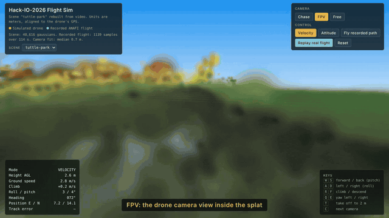

# Hack-IO-2026

A simulator for drone missions, built from drone video of the place you want to fly.

Record a video of an area, and this project aims to rebuild it as a 3D Gaussian splat, drops a simple 6-DOF drone model into it, and lets you fly missions with velocity or attitude commands. With an ANAFI(More to come), it also replays the real flight from the drone's own GPS log, so you can compare the simulated drone against the real one.

Demo scene: Tuttle Park, Columbus OH, rebuilt from two 1 min ANAFI flights on 24 Oct 2026.

## Demo

[Watch the full 41 s demo video](docs/HackIO-2026-demo.mp4): takeoff, velocity mode, FPV, attitude mode, and the autopilot flying the real ANAFI GPS track.

## What it does

| Part | What you get |
|---|---|
| Video to 3D world | `splat/build_scene.py`: frames, camera poses (COLMAP), Gaussian splat training on CPU. Works for any location. |
| Real-world scale | ANAFI GPS read straight from the MP4 metadata (camera path fits GPS to 0.67 m median at Tuttle Park), or a printed ArUco tag(Measured image for depth estimation) for any other camera. |
| Drone model | Position + roll, pitch, yaw. Tilt-driven acceleration, first-order attitude and climb response, drag, 25° tilt and speed limits. |
| Control | Velocity mode (x/y/z velocity + yaw rate), attitude mode (roll, pitch, yaw rate, climb; same inputs as ANAFI manual control), and an autopilot that flies the recorded GPS track and reports tracking error. |
| Views | Chase, FPV (drone camera inside the splat), free orbit. |
| Collision warning | Occupancy grid built from the splat's opaque Gaussians. |
| Desktop app | `HackIO-Sim.exe` runs offline and lists every scene you build. |
| Real drone link | `AnafiUAV` drives a Parrot ANAFI through Olympe; `MockUAV` and a benchmark measure the digital-twin telemetry path. |

## Quick start (Windows)

1. Build a scene: drag your videos onto `build_scene.bat` (first run installs the tools, about 1 GB).
2. Build the app: double-click `build_exe.bat`, then run `dist\HackIO-Sim.exe`.
3. Fly: `W/S` forward/back, `A/D` left/right, `R/F` climb/descend, `Q/E` yaw, `T` take off, `C` change camera.

Linux/macOS: `python splat/build_scene.py video.mp4 --name my-field`, then `python splat/app/sim_launcher.py`.

## Capturing a good scene

Fly or walk a full slow circle around the area with the camera aimed at the center, at two heights, in steady light, with nothing moving through the shot. Lock exposure and keep the zoom at 1x. Add a printed ArUco tag (DICT_4X4_50, id 0) if the camera has no GPS.

## Limitations

The Tuttle Park scene is a proof of concept. Most of its rough edges come from the footage and the hardware, not the pipeline.

- **Camera angle.** The footage was not shot for reconstruction. In the main clip the camera faced north-northwest in about 95% of frames while the drone flew forward, with the gimbal between 0° and -21°. There was no orbit around the area. The splat only looks right from roughly the directions the drone actually looked, and it smears when you turn around.
- **Wind.** It was gusty. Wind pushed the drone off its line and made the footage less steady, and gusts show up in the GPS track. The sim has no wind model, so the autopilot's tracking error compares a calm simulated drone against a real one that was being blown around.
- **Time.** This was built in one hackathon. I got one short session at the field (about 3 minutes of video, flown near sunset), so the light was low, shadows moved, and auto exposure changed from 2.7 to 8 ms during the flight. A person also walks through one clip. I didn't get an ArUco tag into the shot, so scale comes from GPS alone (consumer GPS wanders 1 to 2 m).
- **No NVIDIA GPU.** I had no CUDA GPU, so everything ran on CPU: about 35 minutes to solve camera poses for 165 frames and about 25 minutes to train the splat at 320x180. Each attempt took about an hour, so I couldn't retest with different settings or a new capture. The low training resolution is the main reason the scene is blurry. With a CUDA GPU, nerfstudio or FiGS would train a sharper splat in minutes.
- **Scene content.** An open lawn is hard to reconstruct: the grass looks the same everywhere and the tree line is too far away to give much depth. Most of the detail sits along the path the drone actually flew.
- **Sim model.** The drone model is intentionally simple. It has no thrust, body-rate or motor model and no wind. Collision checking only warns when the drone gets close to something; the drone doesn't physically stop or bounce. Splat-Nav-style ellipsoid collision and corridor planning are not built yet.
- **Telemetry support.** Automatic GPS scaling only works with ANAFI videos (Parrot video metadata). Other cameras need the ArUco tag, or the scene uses approximate units.

## Next steps

- Re-fly Tuttle Park on a calm day: a full orbit at about 2 m and 4 m with the camera on the center, plus an ArUco tag.
- Train on a CUDA GPU at full resolution.
- Add wind and a thrust plus body-rate drone model, then compare sim and real tracks again.
- Mission editor with Splat-Nav-style safe corridors.

## Layout

- `splat/`: scene builder (`build_scene.py`, `mp4meta.py`, `train_gs.py`), sim page (`site/`), desktop launcher (`app/`)
- `scenes/`: built scenes (Tuttle Park included)
- `bench/`: ANAFI telemetry extractor, ANAFI ground check, digital-twin latency benchmark
- `python server/`, `godot client/`: the Twinflie orchestrator this project extends, with `MockUAV` and `AnafiUAV` added

## Built on

- [Twinflie](https://github.com/UniCT-ARSLab/Twinflie) (Conti, Santoro, Santoro, IEEE DASC 2023), the digital-twin UAV orchestrator this repo started from. Its original README is in `docs/TWINFLIE_README.md`.
- FiGS / SOUS VIDE (Stanford MSL) for the video-to-splat-to-drone-sim approach, and Splat-Nav for splat-based collision ideas.
- [COLMAP](https://colmap.github.io/) via pycolmap, [three.js](https://threejs.org/), [GaussianSplats3D](https://github.com/mkkellogg/GaussianSplats3D), Parrot [Olympe](https://github.com/Parrot-Developers/olympe).
